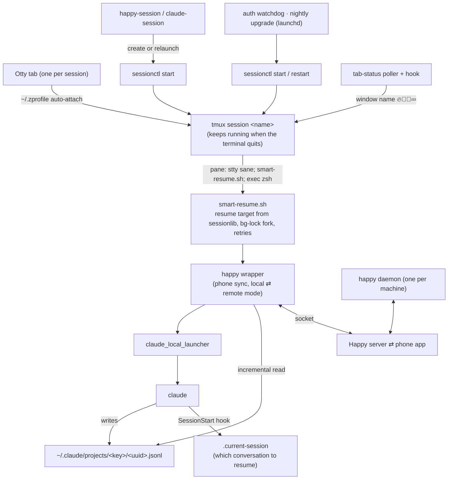

# Claude Workspace Setup

Persistent, named Claude Code sessions on macOS that you can drive from the
terminal and from your phone.

Each session is a tmux session (`~/claude-sessions/<name>`) running Claude Code
under [Happy](https://happy.engineering), shown as one tab in
[Otty](https://otty.sh) (or VS Code). Sessions survive terminal restarts,
resume the same conversation after an exit, and are managed by one command,
`sessionctl`.

## Install

```bash
git clone https://github.com/buallen/claude-workspace-setup.git ~/claude-workspace-setup && \
  bash ~/claude-workspace-setup/setup-workspace.sh && \
  source ~/.zshrc && \
  happy-session "Workspace"
```

Every step is idempotent; re-run it to pick up updates
(`git -C ~/claude-workspace-setup pull && bash ~/claude-workspace-setup/setup-workspace.sh`).

The installer copies `bin/ lib/ hooks/ config/` to `~/.claude/claude-workspace/`,
adds the shell aliases, configures tmux title forwarding, installs the
tab-status poller, links `sessionctl` into `~/.local/bin`, and registers two
Claude Code hooks (conversation marker, pkill guard). Then run
`bin/otty-setup` once if you use Otty.

## Architecture



Who does what: Otty only displays, tmux keeps sessions alive, `sessionctl`
starts/stops/restarts them, `smart-resume.sh` resumes the right conversation
and retries, the happy wrapper syncs with the phone, and `claude` does the
work. Details and the reasons behind each piece: [docs/architecture.md](docs/architecture.md).

## Commands

```bash
happy-session "GCP"                 # create or attach; relaunches an idle pane
happy-session "GCP" <conversation>  # same, but resume that conversation
happy-session-private "Personal"    # the one session with its own config root
claude-session "GCP"                # plain Claude Code, no Happy
end-session "GCP"                   # kill the tmux session
codex-session "Workspace"           # `happy codex` in ~/codex-sessions/<name>

sessionctl status [NAME] [--json]   # state, idle time, live conversation, processes
sessionctl restart NAME [--force]   # clean stop + start on the same conversation
sessionctl stop NAME [--force]      # stop the agent, keep the tab at a shell
sessionctl start NAME               # start it again (no-op if running)
sessionctl idle --hours 24          # sessions idle or waiting for 24 h+
```

`sessionctl` refuses to stop a busy session (tool command running, transcript
written in the last 3 minutes, working indicator on screen, bg-agent job)
unless `--force`, holds one lock per session (exit 75 if another caller has
it), and only targets exact session names.

## Session lifecycle, and why it is built this way

- **Start without typing.** Agents are launched with `tmux respawn-pane`, not
  by typing a command into the pane. A Claude that was killed leaves the pty
  in raw mode; typed commands are then not submitted and a new Claude exits
  at once. The pane command runs `stty sane` first.
- **Stop in happy's order.** `SIGTERM` the happy wrapper and wait; it exits
  without killing claude. Then stop the orphaned launcher before claude (the
  launcher respawns a dead claude), then repair the pane's terminal mode.
  Every signal is re-checked against the pid's start time and command line.
- **One source for "which conversation".** Claude Code fires `SessionStart`
  on startup, resume, `/clear` and `/compact`; `hooks/session-marker.py`
  records the id in `~/claude-sessions/<name>/.current-session`, but only for
  the session's main Claude, whose parent is the pane's launcher or happy
  wrapper (not forks, bg-agent jobs or a one-off `claude -p`). Everything
  else reads the marker through `lib/sessionlib.py`.
- **No auto-sleep.** A stopped session can be resumed from the phone, but
  that starts a headless process outside tmux, and messages sent while it was
  stopped are skipped. Idle sessions are reported instead (`sessionctl idle`,
  daily via `ops/log-janitor.sh`).

## Otty

```bash
bin/otty-setup                      # install Otty + font + theme, migrate sessions
bin/otty-workspace                  # attach tabs for tmux sessions that have none
```

Otty tab shells are login shells, so the auto-attach block lives in
`~/.zprofile`: a shell started by Otty in `~/claude-sessions/<name>` attaches
to tmux session `<name>`, creating it with `happy-session` if needed. Back up
Otty's `state.db` before touching tabs; it is the only place tab order is
stored (`ops/log-janitor.sh` keeps 7 daily copies).

## Tab status

`tab-status/tab-status-poller.py` (launchd, every 5 s) and the
`tab-status.sh` hook keep each tmux window name, and so the terminal tab
title, in sync: 🔥 working · 🤖 background job · 🫵 waiting for you · 💤 idle.
The poller owns the working states (remote and background work fires no local
hook); the hook owns the resting states.

## Personal session

`Personal` runs with `CLAUDE_CONFIG_DIR=~/.claude-private`, so its transcripts
and OAuth credential stay separate from every other session (and out of
anything that scans `~/.claude/projects`). `claude-session` refuses to start
it without that config dir; `lib/personal_history.py` selects its conversation
by the latest real message, never by file mtime.

## Happy

The CLI is the npm package `happy` (formerly `happy-coder`). Until
[slopus/happy#1915](https://github.com/slopus/happy/pull/1915) ships, apply
the incremental-scanner patch after every install or upgrade — without it each
session re-reads its whole transcript every 3 seconds:

```bash
python3 ops/patch-happy-scanner-incremental.py   # or ops/patch-happy.sh (all patches)
sessionctl restart "<name>"                      # per session, to load it
```

Note: on happy 1.2.5 every `happy` invocation, even `--version`, registers a
session with the server.

## Ops (optional, personal automation)

`ops/` holds the launchd jobs this setup runs on its author's machine; review
paths before installing them elsewhere. Private settings such as the Lark
recipient go in `~/.config/claude-workspace/local.env` (not in git):

```bash
LARK_NOTIFY_USER_ID="ou_..."
```

- `claude-auth-watchdog.sh` (every 10 min): restarts a session whose agent
  died, and runs the in-session `/login` flow only when the conversation's
  last turn is Claude Code's own `authentication_failed` error.
- `claude-nightly-upgrade.sh` (04:00): upgrades Claude Code every night; every
  14 days it also `sessionctl restart`s idle sessions still running an older
  version (a new session always starts on the current one, so only long-lived
  sessions lag). Override with `--force-restart`.
- `log-janitor.sh` (hourly): log rotation and disk watermarks; daily Otty
  backup, idle-session report and a check that the happy patch is still in place.

## Repository layout

```text
bin/          sessionctl, claude-session, smart-resume.sh, otty-setup, otty-workspace, ...
lib/          sessionlib.py (paths, processes, state, conversation), session.sh,
              personal_history.py, vscode_restore.py
hooks/        session-marker.py, guard-pkill.py, other Claude Code hooks
tab-status/   tab emoji poller + hook + LaunchAgent
ops/          launchd jobs and happy dist patches (optional)
tests/        unit tests + verify-lifecycle.sh (isolated tmux, fake happy/claude)
```

## Tests

```bash
python3 -m pytest tests -q          # unit tests
bash tests/verify-lifecycle.sh      # sessionctl end to end on a private tmux server
```

## Requirements

macOS, Homebrew, tmux, Python 3, Node.js, Claude Code, Happy (`npm i -g happy`),
and Otty or VS Code.
